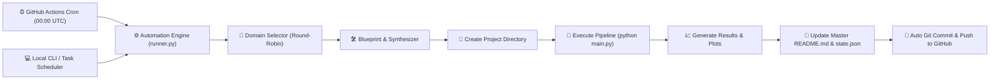

# 🧠 Daily AI, ML, Data Science & Analytics Portfolio

[](projects/)
[](projects/)
[](https://python.org)
[](.github/workflows/daily-project.yml)
[](LICENSE)

> **Autonomous Daily Repository**: Every single day, an automated pipeline designs, tests, builds, and commits a production-ready, self-contained project spanning **Data Science**, **Data Analytics**, **Machine Learning**, **Deep Learning**, **NLP**, and **Artificial Intelligence**.

---

## 📊 Domain Distribution Matrix

|  | **5** projects |
|  | **5** projects |
|  | **5** projects |
|  | **5** projects |
|  | **4** projects |
|  | **4** projects |

---

## 📂 Daily Project Showcase Directory

| Day | Domain | Project & Architecture | Core Tools / Techniques | Status |
| :---: | :---: | :--- | :--- | :---: |
| **Day 028** |  | [LSTM Recurrent Network for Multivariate Financial Series (Advanced Iteration 2)](https://github.com/abhishektotre/dl-lstm-recurrent-stock-trend-forecaster-v2) | `Deep Learning`, `Predictive Analytics`, `Machine Learning` | ✅ Completed |
| **Day 027** |  | [Industrial IoT Equipment Failure & Remaining Useful Life (Advanced Iteration 2)](https://github.com/abhishektotre/ml-industrial-iot-predictive-maintenance-v2) | `Machine Learning`, `Predictive Analytics`, `Machine Learning` | ✅ Completed |
| **Day 026** |  | [Digital Marketing Multi-Touch Attribution Modeling (Advanced Iteration 2)](https://github.com/abhishektotre/da-marketing-multi-touch-attribution-v2) | `Data Analytics`, `Predictive Analytics`, `Machine Learning` | ✅ Completed |
| **Day 025** |  | [Supply Chain Lead-Time & Disruption Predictor (Advanced Iteration 2)](https://github.com/abhishektotre/ds-supply-chain-disruption-predictor-v2) | `Data Science`, `Predictive Analytics`, `Machine Learning` | ✅ Completed |
| **Day 024** |  | [Patient Mortality Risk Stratification & Clinical Biomarkers (Advanced Iteration 2)](https://github.com/abhishektotre/ds-patient-mortality-risk-stratification-v2) | `Data Science`, `Predictive Analytics`, `Machine Learning` | ✅ Completed |
| **Day 023** |  | [Cellular Network Traffic & Congestion Forecaster](https://github.com/abhishektotre/ds-telecom-network-congestion-forecasting) | `Data Science`, `Predictive Analytics`, `Machine Learning` | ✅ Completed |
| **Day 022** |  | [Deep Denoising Autoencoder for Corrupted Sensor Streams](https://github.com/abhishektotre/dl-denoising-autoencoder-signal-reconstruction) | `Deep Learning`, `Predictive Analytics`, `Machine Learning` | ✅ Completed |
| **Day 021** |  | [Multi-Class Clinical Pathology Diagnostic Engine](https://github.com/abhishektotre/ml-multiclass-genomic-disease-diagnostics) | `Machine Learning`, `Predictive Analytics`, `Machine Learning` | ✅ Completed |
| **Day 020** |  | [E-Commerce Customer RFM Segmentation & Value Matrix](https://github.com/abhishektotre/customer-rfm-segmentation-matrix) | `Data Analytics`, `RFM Segmentation`, `Customer Lifetime Value` | ✅ Completed |
| **Day 019** |  | [Credit Risk Assessment & Default Probability Engine](https://github.com/abhishektotre/credit-risk-assessment-engine) | `Data Science`, `Credit Risk`, `Scorecard` | ✅ Completed |
| **Day 018** |  | [Autonomous ReAct Agent with Dynamic Tool Execution](https://github.com/abhishektotre/autonomous-react-agent-framework) | `AI`, `Autonomous Agents`, `ReAct Framework` | ✅ Completed |
| **Day 017** |  | [Extractive Document Summarization with TextRank Algorithm](https://github.com/abhishektotre/extractive-text-summarization-textrank) | `NLP`, `TextRank`, `PageRank` | ✅ Completed |
| **Day 016** |  | [Deep Autoencoder for Unsupervised Anomaly Detection](https://github.com/abhishektotre/deep-autoencoder-anomaly-detection) | `Deep Learning`, `Autoencoder`, `Anomaly Detection` | ✅ Completed |
| **Day 015** |  | [Automotive Residual Value Depreciation Engine](https://github.com/abhishektotre/ml-vehicle-residual-value-gradient-boosting) | `Machine Learning`, `Predictive Analytics`, `Machine Learning` | ✅ Completed |
| **Day 014** |  | [E-Commerce Customer Transaction & Basket Value Analytics](https://github.com/abhishektotre/ecommerce-customer-transaction-analytics) | `Data Analytics`, `Pareto Analysis`, `Basket Value` | ✅ Completed |
| **Day 013** |  | [Kaplan-Meier Survival Duration & Hazard Modeling](https://github.com/abhishektotre/clinical-survival-duration-analysis) | `Data Science`, `Survival Analysis`, `Kaplan-Meier` | ✅ Completed |
| **Day 012** |  | [Retrieval-Augmented Generation (RAG) Architecture with Vector Indexing](https://github.com/abhishektotre/retrieval-augmented-generation-rag-engine) | `AI`, `RAG`, `Vector Search` | ✅ Completed |
| **Day 011** |  | [Multi-Aspect Customer Feedback Sentiment & Emotion Engine](https://github.com/abhishektotre/multi-aspect-sentiment-analysis-engine) | `NLP`, `Sentiment Analysis`, `TF-IDF` | ✅ Completed |
| **Day 010** |  | [Deep Multi-Layer Perceptron (MLP) with Adam & Backprop from Scratch](https://github.com/abhishektotre/deep-mlp-neural-network-from-scratch) | `Deep Learning`, `Neural Networks`, `Backpropagation` | ✅ Completed |
| **Day 009** |  | [Real Estate Valuation with Stacking Regression Ensemble](https://github.com/abhishektotre/real-estate-valuation-stacking-ensemble) | `Machine Learning`, `Stacking Regressor`, `Ensemble Methods` | ✅ Completed |
| **Day 008** |  | [Epidemiological Time-Series Trends & Public Health KPI Dashboard](https://github.com/abhishektotre/epidemiological-time-series-analytics-dashboard) | `Data Analytics`, `Time Series`, `Rolling Averages` | ✅ Completed |
| **Day 007** |  | [Bank Marketing Term Deposit Predictive Engine](https://github.com/abhishektotre/bank-marketing-term-deposit-predictive-engine) | `Data Science`, `Banking Analytics`, `Term Deposit` | ✅ Completed |
| **Day 006** |  | [Smart Expense Assistant with Autonomous Agent Workflows](https://github.com/abhishektotre/smart-expense-assistant-autonomous-workflow-agent) | `AI`, `Autonomous Workflows`, `Financial Agent` | ✅ Completed |
| **Day 005** |  | [Real-Time Stock Market Sentiment & Financial News Analytics Engine](https://github.com/abhishektotre/real-time-stock-market-sentiment-analysis-engine) | `NLP`, `Financial Sentiment`, `VADER` | ✅ Completed |
| **Day 004** |  | [Odontometric Biometric Gender Classification with Deep Neural Networks](https://github.com/abhishektotre/odontometric-biometric-gender-classification-deep-learning) | `Deep Learning`, `Biometrics`, `Neural Networks` | ✅ Completed |
| **Day 003** |  | [High-Precision Financial Fraud Detection with XGBoost](https://github.com/abhishektotre/credit-card-fraud-detection-xgboost) | `Machine Learning`, `XGBoost`, `Imbalanced Data` | ✅ Completed |
| **Day 002** |  | [SaaS Monthly Cohort Retention & Churn Analytics](https://github.com/abhishektotre/saas-cohort-retention-analytics) | `Data Analytics`, `Cohort Analysis`, `Retention Matrix` | ✅ Completed |
| **Day 001** |  | [Customer Churn Prediction & Retention Analytics](https://github.com/abhishektotre/customer-churn-prediction) | `Data Science`, `EDA`, `Feature Engineering` | ✅ Completed |

---

## 🏗️ Architecture & Automated Execution Flow

The system runs autonomously via **GitHub Actions** (cloud cron) and can also be triggered **locally** via CLI:



Each daily project folder is **100% self-contained** and includes:
- `README.md` (Detailed problem statement, architectural diagram, metrics, and instructions)
- `main.py` (End-to-end runnable entrypoint)
- `src/` (Clean, modular code: data generators, model trainers, evaluation engines)
- `data/` (Synthetic realistic datasets generated on-the-fly)
- `results/` (Generated metric scorecards, confusion matrices, and EDA plots)
- `requirements.txt` (Pinned dependencies)

---

## 🚀 Running Any Project Locally

To run any daily project on your local machine:

```bash
# 1. Clone the repository
git clone <your-repo-url>
cd <repo-folder>

# 2. Enter any day's project folder
cd projects/Day_001_Customer_Churn_Prediction

# 3. Install project dependencies
pip install -r requirements.txt

# 4. Run the end-to-end pipeline
python main.py
```

---

## ⚙️ Triggering the Automation Manually

You can trigger the generator anytime locally:

```bash
# Generate and execute the next daily project
python automation/runner.py --generate --execute

# Generate, execute, and push immediately to GitHub
python automation/runner.py --generate --execute --push

# Check portfolio status and stats
python automation/runner.py --status
```

*Last synchronized: `2026-10-30 00:18:42 UTC`*
